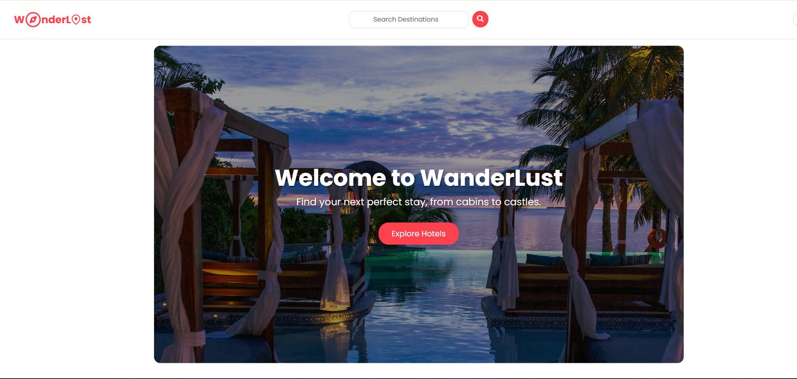
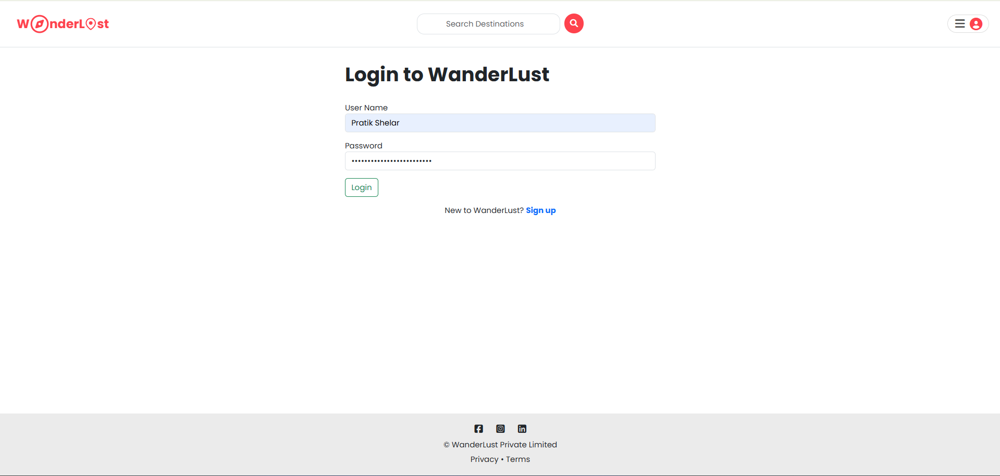
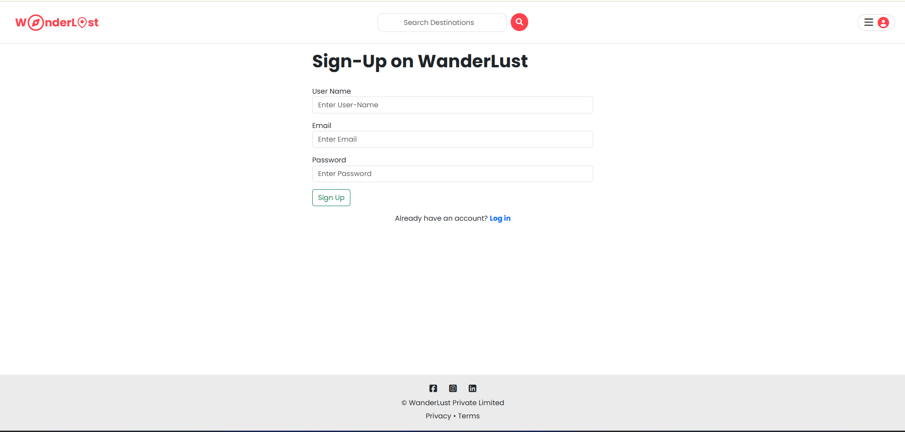
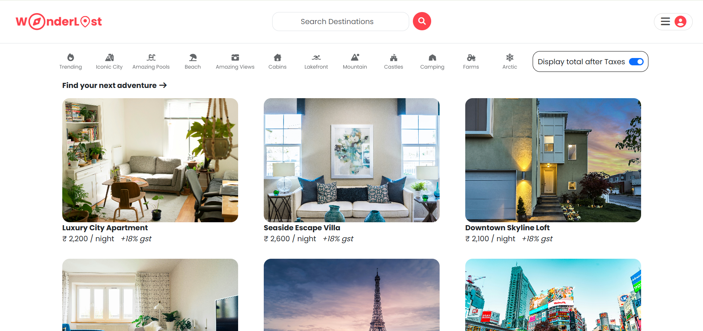
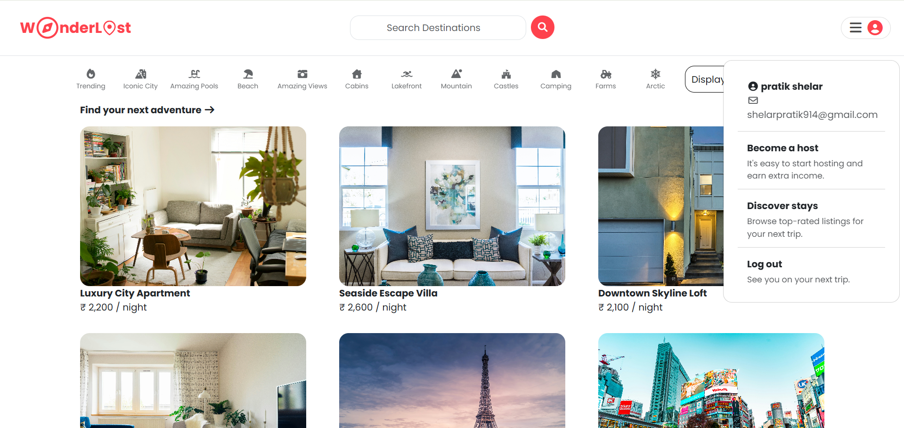
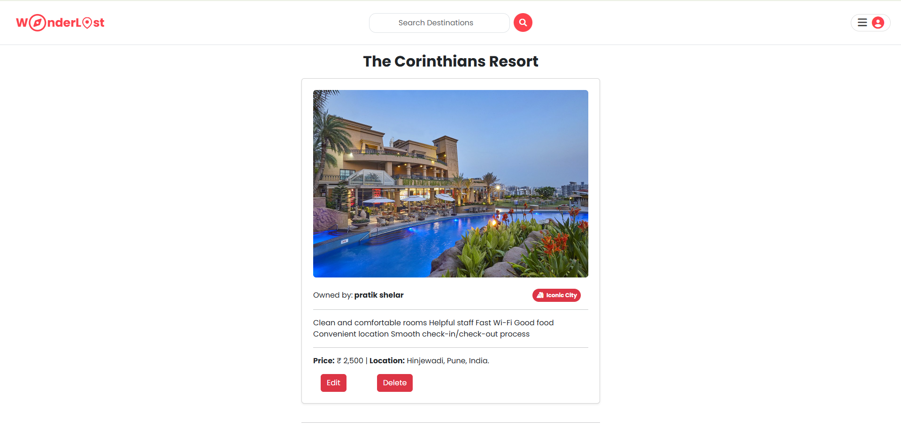
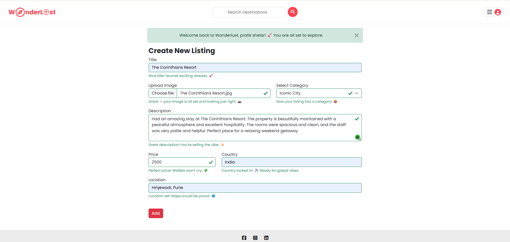
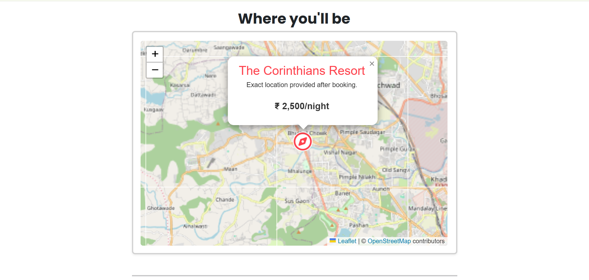
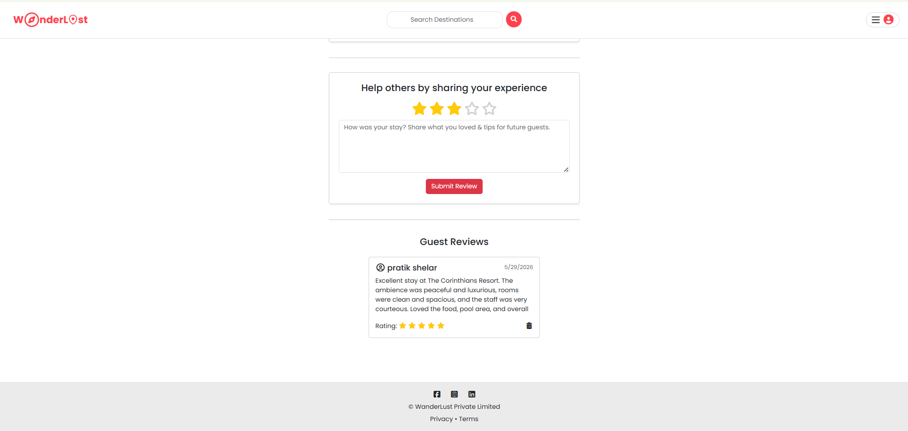

# WanderLust - Full Stack Travel Stay Platform

<div align="center">


**An Airbnb-inspired full stack web application for discovering, creating, and reviewing travel stays.**

[GitHub](https://github.com/yashraykar0264) | [LinkedIn](https://www.linkedin.com/in/yash-raykar-72901231b/) | [Email](mailto:raykaryash45@gmail.com)

</div>

---

## Recruiter Snapshot

| Project Type | Full stack travel stay marketplace |
| --- | --- |
| Main Focus | Backend architecture, authentication, authorization, CRUD, cloud uploads, maps, and database relationships |
| Built With | Node.js, Express.js, MongoDB, Mongoose, EJS, Passport.js, Cloudinary, Leaflet |
| Best For | Demonstrating real-world Express/MongoDB development skills in interviews |
| Status | Portfolio-ready with screenshots, local setup, and seed data |

## Project Overview

WanderLust is a production-style travel accommodation platform built with **Node.js, Express.js, MongoDB, EJS, Passport.js, Cloudinary, and Leaflet**. Users can explore stays, search by location, filter by category, create listings, upload property images, view map-based locations, and add reviews.

The project is structured like a real-world MVC application instead of a small demo script. It includes authentication, authorization, validation, persistent sessions, cloud image uploads, geocoding, relational MongoDB data modeling, flash messaging, and seed scripts for a ready-to-demo database.

Built and customized by **Yash Raykar** as a major full stack portfolio project.

## My Role

I developed WanderLust as a complete full stack application, focusing on building the kind of project structure and feature depth expected in real production apps. I worked on backend routing, controller separation, MongoDB schema design, authentication, authorization middleware, image uploads, geocoding integration, EJS views, responsive UI, and demo data preparation.

## Why This Project Stands Out

- **Real product flow:** browse stays, inspect details, sign up, log in, create listings, upload images, add reviews, and manage ownership-protected content.
- **Clean backend architecture:** routes, controllers, models, middleware, utilities, and views are separated for maintainability.
- **Security-aware implementation:** password hashing, session persistence, protected routes, owner-only listing actions, and review-author permissions.
- **Cloud-ready services:** MongoDB Atlas for data, Connect Mongo for sessions, Cloudinary for uploads, and environment-based configuration.
- **Map integration:** listing locations are geocoded through Nominatim and rendered using Leaflet with OpenStreetMap tiles.
- **Demo-friendly seed data:** one command prepares users, listings, images, reviews, owners, and review authors.

## Demo Walkthrough

1. Land on the home/explore page and browse the travel stay experience.
2. Sign up or log in using Passport.js authentication.
3. Browse listings, filter by category, or search by city/country.
4. Open a listing to view details, owner information, reviews, and map location.
5. Create a new listing with image upload and location-based map coordinates.
6. Edit or delete only the listings owned by the logged-in user.
7. Add reviews as an authenticated user and delete only your own reviews.

## Screenshots

### Welcome / Explore



### Authentication





### Listings Experience





### Listing Details, Maps, And Reviews









## Tech Stack

| Area | Technologies |
| --- | --- |
| Frontend | HTML, CSS, JavaScript, Bootstrap, EJS, EJS-Mate |
| Backend | Node.js, Express.js |
| Database | MongoDB Atlas, Mongoose |
| Authentication | Passport.js, Passport Local, Passport Local Mongoose |
| Sessions | Express Session, Connect Mongo |
| File Uploads | Multer, Cloudinary, Multer Storage Cloudinary |
| Validation | Joi |
| Maps | Leaflet, OpenStreetMap, Nominatim |
| Utilities | Dotenv, Method Override, Connect Flash |

## Core Features

### User Authentication

- Signup, login, and logout flows.
- Password hashing handled by Passport Local Mongoose.
- Session-based authentication using Express Session.
- MongoDB-backed session store through Connect Mongo.
- Redirect support after protected-route login.

### Listings

- View all travel stay listings.
- Search listings by city, location, or country.
- Filter listings by categories such as Beach, Mountain, Camping, Farms, Castles, Lakefront, and more.
- Create, edit, and delete listings.
- Upload listing images directly to Cloudinary.
- Owner-only edit and delete controls.
- Automatic cleanup of related reviews when a listing is deleted.

### Reviews

- Authenticated users can add reviews to listings.
- 1 to 5 star rating support.
- Reviews are connected to both listings and users.
- Only the review author can delete their review.

### Maps And Geocoding

- Location and country are converted into coordinates using Nominatim.
- Coordinates are stored in a GeoJSON-style `Point` field.
- Leaflet renders the listing location on an interactive map.

### Validation And Error Handling

- Joi schemas validate listing and review input on the server.
- Custom Express error handler renders user-friendly error pages.
- Flash messages provide clear success, warning, and error feedback.

### Demo Data Seeding

- Seeds realistic demo users, listings, and reviews.
- Assigns owners to listings.
- Ensures review authors are different from listing owners.
- Useful for portfolio demos and interview walkthroughs.

## Architecture

```txt
Browser
  -> Express Routes
  -> Middleware / Joi Validation
  -> Controllers
  -> Mongoose Models
  -> MongoDB Atlas
  -> EJS Views
  -> Browser Response
```

Image upload flow:

```txt
Listing Form
  -> Multer
  -> Cloudinary Storage
  -> Listing Controller
  -> MongoDB image URL + filename
```

Map flow:

```txt
Location + Country
  -> Nominatim Geocoding
  -> GeoJSON Coordinates
  -> MongoDB
  -> Leaflet Map
```

## Project Structure

```txt
WanderLust-main/
|-- app.js
|-- cloudConfig.js
|-- middleware.js
|-- schema.js
|-- package.json
|-- controllers/
|   |-- listings.js
|   |-- reviews.js
|   |-- users.js
|-- models/
|   |-- listing.js
|   |-- review.js
|   |-- user.js
|-- routes/
|   |-- index.js
|   |-- listing.js
|   |-- review.js
|   |-- user.js
|-- views/
|   |-- layouts/
|   |-- includes/
|   |-- listings/
|   |-- pages/
|   |-- users/
|-- public/
|   |-- assets/
|   |-- css/
|   |-- js/
|-- init/
|   |-- init.js
|   |-- seedUsers.js
|   |-- seedListingsAndReviews.js
|   |-- advanceData/
|-- utils/
|   |-- category.js
|   |-- ExpressError.js
|   |-- geoData.js
|-- docs/
|   |-- screenshots/
```

## Local Setup

### 1. Clone The Repository

```bash
git clone https://github.com/yashraykar0264/WanderLust.git
cd WanderLust
```

### 2. Install Dependencies

```bash
npm install
```

The project includes `.npmrc` with `legacy-peer-deps=true` to support the current Cloudinary upload dependency combination.

### 3. Configure Environment Variables

Create a `.env` file in the project root:

```env
ATLASDB_URL=your_mongodb_atlas_connection_string
MY_SECRET=your_session_secret

CLOUD_NAME=your_cloudinary_cloud_name
CLOUD_API_KEY=your_cloudinary_api_key
CLOUD_API_SECRET=your_cloudinary_api_secret

SEED_USER_PASSWORD=your_demo_user_password
```

### 4. Run The Application

```bash
npm start
```

Open the app:

```txt
http://localhost:8080
```

### 5. Seed Demo Data

```bash
node init/init.js
```

This command clears existing users, listings, and reviews before inserting demo data. Use it only for local development or portfolio demos.

## Environment Services

| Service | Purpose |
| --- | --- |
| MongoDB Atlas | Stores users, listings, reviews, and sessions |
| Cloudinary | Stores uploaded listing images |
| OpenStreetMap / Nominatim | Converts listing locations into coordinates |
| Leaflet CDN | Displays interactive maps in the browser |

## Engineering Decisions

- Used **MVC architecture** so route definitions stay small and business logic lives in controllers.
- Used **Passport Local Mongoose** to avoid manually handling password hashing and authentication edge cases.
- Used **Connect Mongo** so sessions persist beyond server restarts and are not stored in memory.
- Used **middleware-based authorization** to keep access-control rules reusable across routes.
- Used **Joi validation** before controller logic so invalid data is rejected early.
- Used **Cloudinary** instead of local uploads so listing images can be stored reliably outside the server filesystem.
- Used **Leaflet + OpenStreetMap** as an open-source map solution instead of relying on paid map APIs.
- Used **seed scripts** so the project can be quickly demonstrated with meaningful data.

## Interview Talking Points

- I converted the project into a modular MVC structure with controllers, middleware, models, and routes.
- I implemented secure session-based authentication with Passport.js and MongoDB-backed sessions.
- I added owner-based authorization so only listing owners can edit or delete their listings.
- I added review-author authorization so users can manage only their own reviews.
- I integrated Cloudinary uploads with Multer and stored image metadata in MongoDB.
- I used Joi validation to protect create/update routes from invalid request data.
- I connected Nominatim geocoding with Leaflet maps to display listing locations.
- I created seed scripts to quickly prepare a realistic demo database for interviews.
- I used environment variables for secrets and service configuration.

## Resume-Ready Summary

**WanderLust - Full Stack Travel Stay Platform**

- Built a full stack Airbnb-inspired web application using Node.js, Express.js, MongoDB, EJS, Passport.js, Cloudinary, and Leaflet.
- Implemented authentication, protected routes, owner-based authorization, review permissions, image uploads, server-side validation, and map-based listing locations.
- Designed a maintainable MVC backend with separated routes, controllers, models, middleware, utilities, and views.
- Integrated MongoDB Atlas, Mongoose relationships, Cloudinary storage, and MongoDB-backed sessions for a production-style architecture.

## What I Learned

- Designing maintainable Express applications using MVC architecture.
- Modeling relationships in MongoDB with Mongoose refs and populate.
- Protecting routes with authentication and authorization middleware.
- Handling file uploads through a third-party cloud storage service.
- Building full CRUD workflows with server-rendered EJS pages.
- Preparing a project so another developer or interviewer can run it locally.

## Author

**sushil pawar**


<div align="center">

**Built with care by Sushil Pawar**

</div>
